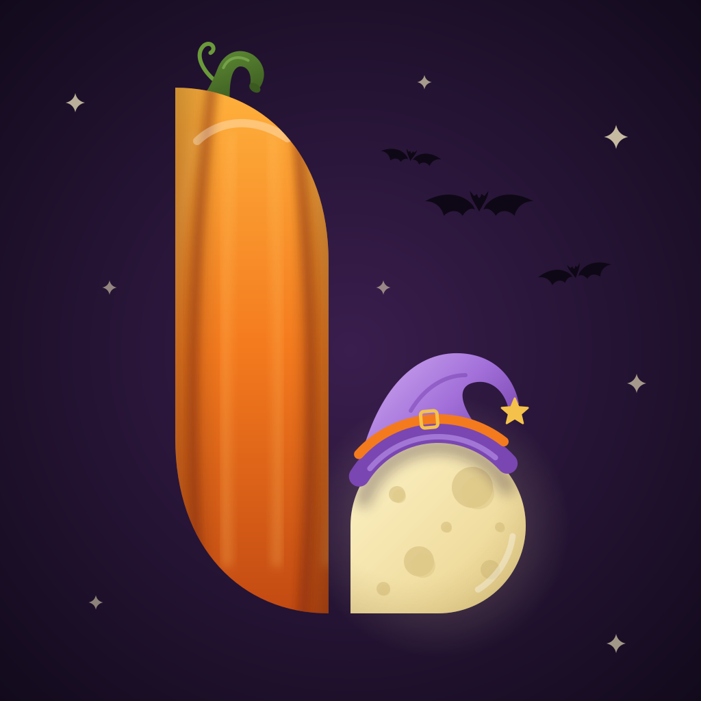

<p align="center">
  
</p>

<p align="center">
  <a href="https://github.com/ItsLucas">
    
  </a>
</p>

<p align="center">
  <a href="https://github.com/ItsLucas?tab=followers"></a>
  <a href="https://github.com/ItsLucas?tab=repositories"></a>
</p>

<p align="center"><sub>Current theme: **Spooky Moon** · Halloween</sub></p>

---

## 🧑‍💻 About me

```java
public final class ItsLucas {
    String   role      = "Developer";
    String   location  = "France 🇫🇷";
    String[] languages = { "Java", "HTML", "CSS", "JavaScript" };
    String[] systems   = { "Linux", "Windows" };
    String   status    = "Always learning something new";
}
```

---

## 🛠️ Languages

<p align="center">
  
</p>

## 💻 Environment

<p align="center">
  
</p>

---

## 📊 Stats

<p align="center">
  
  
</p>

<p align="center">
  
</p>

<p align="center">
  
</p>

<p align="center">
  <picture>
    <source media="(prefers-color-scheme: dark)" srcset="https://raw.githubusercontent.com/ItsLucas/ItsLucas/output/snake-dark.svg"/>
    
  </picture>
</p>

---

<p align="center">
  
  <br/>
  <sub>The logo and banner change automatically with the time of year.</sub>
  <br/><br/>
  
</p>
